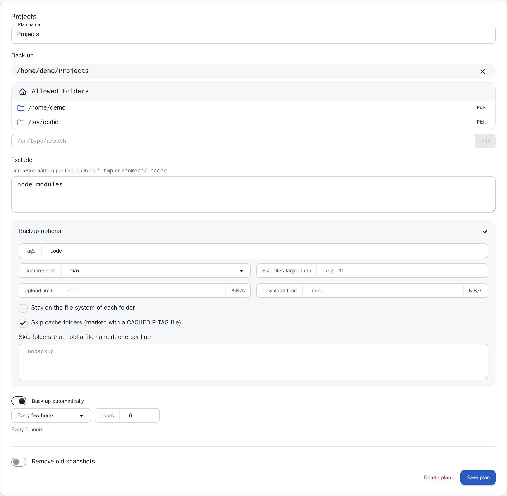
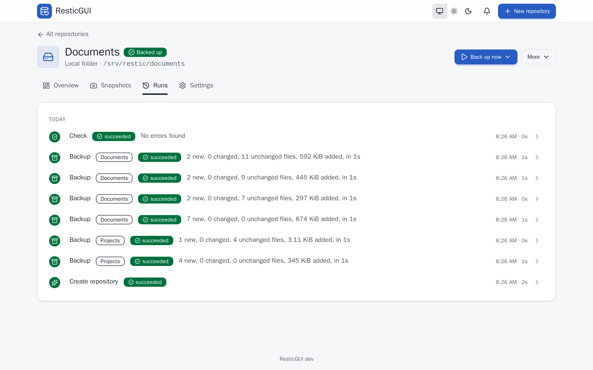
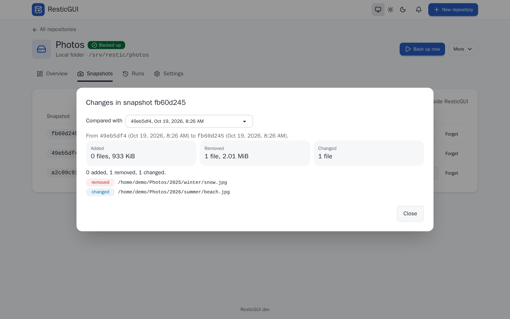

# ResticGUI

A web interface for [restic](https://restic.net): set up backups, see that they
run, and get your files back, from a browser. Your backups stay plain restic
repositories that the restic command line can always read.

**Documentation: [docs.resticgui.com](https://docs.resticgui.com)**


## What it does

- **Repositories** on a local disk, Amazon S3 and S3-compatible storage,
  Backblaze B2, a REST server, SFTP, rclone, Azure Blob Storage or Google Cloud
  Storage. Create a new one or connect one you already use.
- **Backup plans**: several sets of folders in one repository, each with its
  own schedule, exclusions, restic options and retention, such as photos every
  night and documents every hour, with identical data stored once.
- **Retention** with a preview of which snapshots each rule keeps and which it
  removes, and prune afterwards.
- **Live progress** of every backup, and a history of every run with its log.
- **Browse, download and restore** files and folders from any snapshot, and see
  what changed between two snapshots.
- **Notifications** by ntfy, Gotify, Discord, Slack, Telegram, email and more,
  Healthchecks.io pings, and **hooks**: a command or a webhook before and after
  each backup.
- **Prometheus metrics** with a ready-made Grafana dashboard.
- A login, encrypted credentials, and a light and a dark theme that work on a
  phone.

## Quick start

With Docker, mount the folders to back up and a folder for the repositories:

```sh
docker run -d --name resticgui --restart unless-stopped \
  -p 127.0.0.1:3001:3030 \
  -v resticgui:/opt/db \
  -v /home:/backup/home:ro \
  -v /srv/restic:/repositories \
  ghcr.io/mathieuha/resticgui:latest
```

Open http://127.0.0.1:3001/ui/ and click **New repository**: choose where the
backups go (for this example, a local folder under /repositories), pick the
folders to back up under /backup/home, and keep the suggested schedule. Then
**Back up now** runs the first backup.

The image includes restic and runs on linux/amd64, linux/arm64 and
linux/arm/v7. The documentation has the same quick start
[with Docker](https://docs.resticgui.com/install/docker),
[on Linux](https://docs.resticgui.com/install/linux) as a systemd service, and
[on Kubernetes](https://docs.resticgui.com/install/kubernetes), each ending
with [a first backup](https://docs.resticgui.com/guide/first-backup).

Without a password, anyone who reaches ResticGUI can read your backups. The
examples listen on 127.0.0.1 only; set a
[login](https://docs.resticgui.com/reference/security) before you open it to a
network.

## Screenshots

A repository with two backup plans, in the dark theme:


A backup plan, with its folders, options and schedule:



Every run, with the plan it belongs to:



Browsing a snapshot, and what changed since the snapshot before:




The retention preview:


The screenshots come from a demo server with made-up data. To take them again,
run make screenshots (it needs Docker).

## Configuration

Repositories, plans, schedules, notifications and hooks are set in the web
interface. The configuration file holds what the server needs to start: where
it listens, where its database is, the login, and which folders may be backed
up. See the [configuration reference](https://docs.resticgui.com/reference/configuration).

Upgrading from ResticGUI 0.1 imports its repositories, folders, schedules and
retention policies: see [upgrading](https://docs.resticgui.com/reference/upgrading).

## Roadmap

- **Maintenance tools**: unlock, repair, a partial data check and a password
  change, from the interface.
- **Copy to a second repository** with restic copy, for 3-2-1 backups.
- **Configuration from environment variables** for container deployments.

Suggestions are welcome in the [issues](https://github.com/mathieuHa/resticgui/issues).

## Development

ResticGUI is a Go server with a Svelte web interface, which the binary embeds.
You need Go, Node.js and restic.

```sh
make build       # the web interface, the server and restic, in dist/
make run         # run the server on http://localhost:3001/ui/
make rundevweb   # the web interface with live reload on http://localhost:3000/ui/
make testgo      # Go tests
make testweb     # web interface checks and unit tests
make e2e         # browser tests against the built binary and real restic
make help        # every target
```

The API is described by its OpenAPI document at /api/v2/openapi.yaml on a
running server.

## License

ResticGUI is licensed under the [GPL 3.0](https://www.gnu.org/licenses/gpl-3.0.txt).
The complete text is in [COPYING](COPYING).

## About

[maxlerebourg](https://github.com/maxlerebourg) and
[I](https://github.com/mathieuHa) have been using restic since 2020 at
[Primadviz](https://primadviz.com). We come from web development and security
engineering, and wanted a web interface that makes restic easy to set up and
use.
