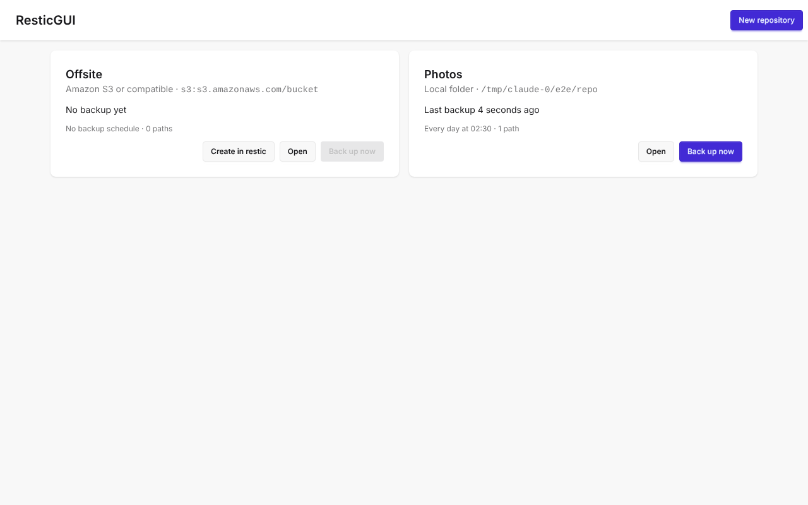
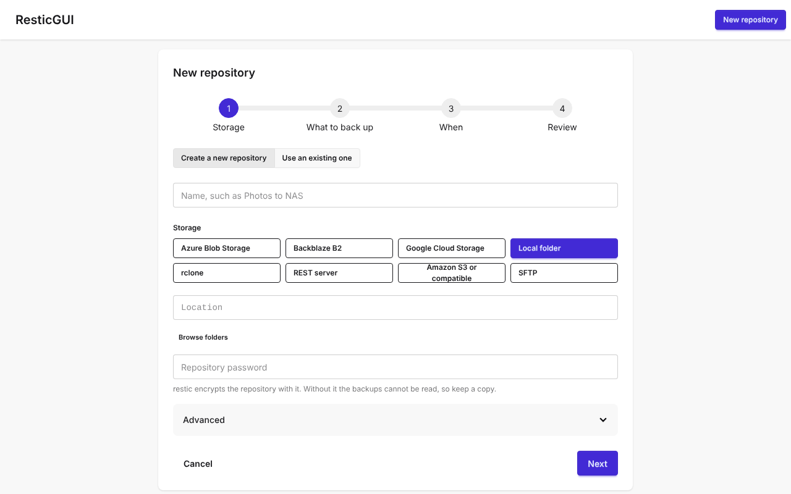
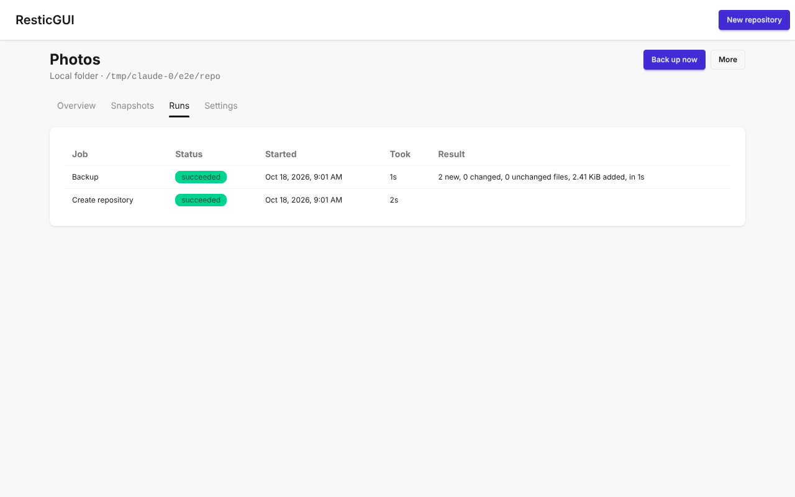

# ResticGui

A smart GUI for Restic [github.com/restic/restic](https://github.com/restic/restic)

**Documentation: [docs.resticgui.com](https://docs.resticgui.com)**

It features a complete web interface that ease configuration of:
- scheduling backups
- retention policy, with a preview of what it will delete
- storage provider configuration
- selecting paths from file tree navigation
- notifications (ntfy, Gotify, Discord, Slack, Telegram, email and more) and Healthchecks.io pings
- hooks: a command or webhook before and after a backup

The following actions are supported:
- a dashboard with the status, size and history of every repository
- starting a backup and following its progress live
- importing an existing restic repository
- listing Snapshots, and comparing two of them
- removing specific Snapshot
- show statistics of a specific Snapshot
- search for files in a Snapshot
- downloading or restoring files or directories from a Snapshot
- Prometheus metrics, with a ready-made Grafana dashboard

The following storage backends are supported: local folder, Amazon S3 and S3-compatible storage, Backblaze B2, REST server, SFTP, rclone, Azure Blob Storage and Google Cloud Storage.

ResticGUI needs restic 0.17.0 or newer. The Docker image includes it; a standalone binary needs it in the $PATH.

## Screenshots

### Repositories


### New repository


### Backup runs


## Install

The [installation guide](https://docs.resticgui.com/install/docker) covers Docker, Linux (systemd) and Kubernetes.

### Run with docker

The image holds ResticGUI and restic, for linux/amd64, linux/arm64 and linux/arm/v7. Mount the folders to back up under /backup:

```bash
docker run -d --name resticgui --restart unless-stopped \
  -p 127.0.0.1:3001:3030 \
  -v resticgui:/opt/db \
  -v /home:/backup/home:ro \
  ghcr.io/mathieuha/resticgui:latest
```

Then open http://127.0.0.1:3001/ui/

### Run as binary

Download a binary for your architecture from the [releases](https://github.com/mathieuHa/resticgui/releases), with restic 0.17.0 or newer in the $PATH, and see the [Linux guide](https://docs.resticgui.com/install/linux).

## Configure

Configuration is made in the config.yaml file.  
The config.yaml must be place in the same directory as the resticgui binary.  

### Variables

- **logs.debug** (bool, default false): enable the debug logs (overrides logs.level)
- **logs.level** (int, default 1): zerolog levels, 0 debug, 1 info, 2 warn, 3 error
- **server.ip** (default 127.0.0.1) and **server.port** (default 3001): where the web server listens
- **store.path** (default resticgui.sqlite): the SQLite database, created on the first start
- **store.key_file** (default resticgui.key): the key that encrypts repository passwords and credentials, created if missing; $RESTICGUI_SECRET_KEY takes precedence. Keep a copy: without it the stored passwords cannot be read.
- **store.legacy_path** (default resticgui.db): a ResticGUI v0.1 database, imported once when store.path does not exist yet. The import can also be run by hand with resticgui migrate-legacy -from resticgui.db -to resticgui.sqlite.
- **restic.bin** (default restic): the restic binary
- **jobs.workers** (default 2): how many restic commands may run at once
- **jobs.schedule** (default true): run the scheduled backups, forget/prune and checks
- **paths.roots** (default empty, meaning everything): directories that may be backed up, restored into and browsed
- **auth.username** and **auth.password_hash**: the login. Make the hash with resticgui hash-password (it reads the password on stdin). With no hash the API needs no login, so only do that on a trusted network.

### Example
```yaml
logs:
  debug: false
  level: 1

server:
  ip: "127.0.0.1"
  port: 3001

store:
  path: resticgui.sqlite
  key_file: resticgui.key

paths:
  roots: [/home/myuser]

auth:
  username: admin
  password_hash: "$2a$10$..."
```


### Demo environment

A public demo environment is available at [demo.resticgui.com](https://demo.resticgui.com)  
It is reinitialized every hour and do not persist data between restarts. 

## Roadmap

Features we plan to work on, roughly in this order. Suggestions are welcome in the issues.

- **Security review** of the whole application before 1.0.
- **Backup plans**: several sets of paths, each with its own schedule and retention, into one repository; exclude patterns and per-plan restic options.
- **Maintenance tools**: unlock, repair, partial data check, password change.
- **Copy to a second repository** (restic copy) for 3-2-1 backups.
- **Configuration from a file or environment variables** for container deployments.

## Glossary

The Design of Restic component is detailed in [github.com/restic/restic/blob/master/doc/design.rst](https://github.com/restic/restic/blob/master/doc/design.rst)

Extract from this documentation:

> Repository: All data produced during a backup is sent to and stored in a repository in a structured form, for example in a file system hierarchy with several subdirectories. A repository implementation must be able to fulfill a number of operations, e.g. list the contents.

> Snapshot: A Snapshot stands for the state of a file or directory that has been backed up at some point in time. The state here means the content and meta data like the name and modification time for the file or the directory and its contents.

## License

ResticGUI is licensed under [GPL 3.0 License](https://www.gnu.org/licenses/gpl-3.0.txt). You can find the
complete text in [COPYING](COPYING).

## Dev tools


#### Launch Backend server

```
make run
```
> Listen on http://localhost:3001

#### Start dev web server 

```
make rundevweb
```
> Listen on http://localhost:3000/ui, and sends /api to the backend on port 3001

#### Tests

```
make testgo     # Go unit tests
make testweb    # svelte-check, eslint and Vitest
make e2e        # Playwright against the built binary; needs restic, or RESTIC_BIN=/path/to/restic
make genapi     # after changing internal/server/openapi.yaml
```

#### Start container

```
make rundocker
```
> Listen on http://localhost:8000

## Dependancies

### Frontend

#### Install node 24

```
curl -sL https://deb.nodesource.com/setup_24.x | sudo bash -
sudo apt -y install nodejs
```

### Backend

#### Install go

__Linux__
```bash
sudo apt-get install golang-go
# Ou 
wget https://go.dev/dl/go1.27.2.linux-amd64.tar.gz
sudo rm -rf /usr/local/go && sudo tar -C /usr/local -xzf go1.27.2.linux-amd64.tar.gz
```

__Windows__
```bash
choco install go mingw make
```
#### Documentation

The API is described by its OpenAPI document at http://localhost:3001/api/v2/openapi.yaml

### Makefile help

```
all                            Run Build and launch Tests
build                          Build go backend, Web and restic binary
builddocker                    Build the container image for this machine as $(IMAGE):$(TAG)
buildgo                        Build the go backend in dist dir
buildrestic                    Download restic binary in build dir
buildweb                       Build the frontend in dist dir
clean                          Clean build and temporary directory
createdir                      Create the build and package dist dir if not present
docs                           Build the documentation site in docs/.vitepress/dist
docsdev                        Serve the documentation site with live reload on http://localhost:5173
genapi                         Regenerate the frontend API types from internal/server/openapi.yaml
generate                       Regenerate the sqlc queries in internal/store/db
install                        Install the web dependancies and download restic binary
installgo                      Install go on Windows using choco
installweb                     Install the web dependancies in the build dir
installwebdev                  Install the web dependancies for Development
printvars                      Print vars for debug
run                            Run resticgui binary listening on localhost:8080
rundev                         Build and run resticgui binary listening on localhost:8080
rundevweb                      Run dev web listening on localhost:3000
rundocker                      Run the container image locally on http://localhost:8000/ui
smokedocker                    Smoke-test the container image: UI, API and one backup
test                           Launch Tests for the go backend
testgo                         Run the go Tests
testgoci                       Run the go Tests and export coverage
testweb                        Run the frontend checks and unit tests
```

### Library Doc

#### GO Logging documentation

https://github.com/rs/zerolog

#### Configuration documentation

https://github.com/spf13/viper

# About

[maxlerebourg](https://github.com/maxlerebourg) and [I](https://github.com/mathieuHa) have been using Restic since 2020 at [Primadviz](https://primadviz.com).
We come from a web development and security engineer background and wanted to add a wrapper in the form a web UI that facilitate configuration and usage of Restic.
