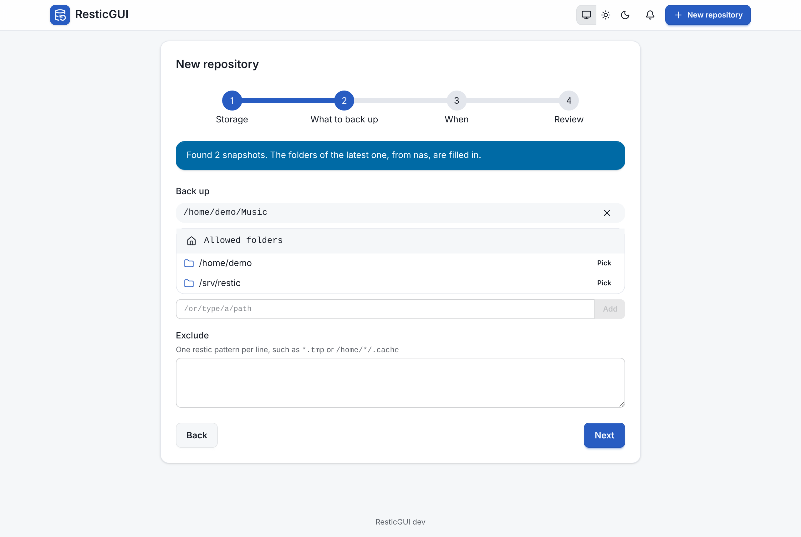

# Existing repositories

A repository made with restic on the command line, by an older backup
script, or by another machine, can be added as it is. ResticGUI does not run
`init` on it, and its snapshots stay untouched.

1. Choose **New repository**, then **Use an existing one**.
2. Enter its storage, location and password, as for a new one.
3. **Next** looks at the location. It says how many snapshots are there,
   and fills in the folders and the host name of the newest one, so that
   your next backups continue the same series.

{.screenshot}

If no repository is there, or the password does not open it, the wizard
says so and stays on the first step. The other way round, **Create a new
repository** at a location that already holds one asks you to connect it
instead, so that an existing repository is never initialized again.

Once added, the **Snapshots** tab lists the snapshots that were already
there, and you can browse, restore, [compare](/features/compare) and
[apply retention](/features/retention) as with any other.

::: tip Retention and old snapshots
ResticGUI's retention policy only removes the snapshots ResticGUI made, so
old snapshots from your scripts stay until you forget them, one by one in
the **Snapshots** tab, or with restic.
:::
