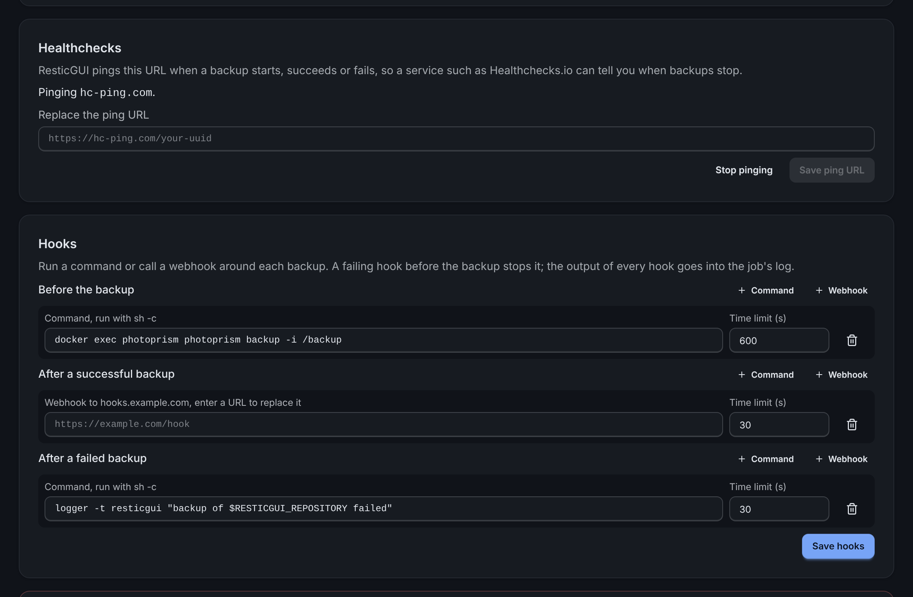

# Hooks

Hooks run around each backup of a repository: before it starts, after it
succeeds, or after it fails. Set them in the repository's **Settings**,
under **Hooks**. Use them to dump a database before the backup, to stop and
start a service, or to tell another system how it went.

{.screenshot}

## Kinds

- **Webhook**: ResticGUI sends a `POST` with a JSON body to the URL. Any
  `2xx` answer is a success. Webhooks need no setting.
- **Command**: ResticGUI runs the command with `/bin/sh -c`, with the rights
  of the ResticGUI process. Because anyone who can use ResticGUI could then
  run commands on the server, commands are off until the configuration
  allows them:

  ```yaml
  hooks:
    commands: true
  ```

  An exit code other than 0 is a failure.

## What a hook receives

A command gets these environment variables; a webhook gets the same values
as a JSON body (`event`, `repository_id`, `repository`, `plan`, `job_id`, `status`,
`snapshot_id`, `error`):

| Variable                  | Value |
| ------------------------- | ----- |
| `RESTICGUI_EVENT`         | `before`, `success` or `failure` |
| `RESTICGUI_REPOSITORY_ID` | The repository's id |
| `RESTICGUI_REPOSITORY`    | The repository's name |
| `RESTICGUI_PLAN`          | The backup plan's name |
| `RESTICGUI_JOB_ID`        | The backup job's id |
| `RESTICGUI_STATUS`        | `succeeded` or `failed`; empty before the backup |
| `RESTICGUI_SNAPSHOT_ID`   | The new snapshot, after a successful backup |
| `RESTICGUI_ERROR`         | Why the backup failed, after a failed one |

## Order, time limits and failures

- Hooks of one event run one after the other, in the order shown.
- Each hook has a time limit, 5 minutes unless set otherwise (1 second to
  24 hours). A hook that runs longer is stopped and counts as failed.
- A **before** hook that fails stops the backup: it does not run, the job
  fails with `before hook N failed: ...`, and the **failure** hooks run.
- A **success** hook that fails keeps the backup succeeded, as the snapshot
  was made; the job shows the hook's error.
- The last lines of each hook's output, or a webhook's answer, go into the
  job's log, marked `[before hook 1]`, `[success hook 1]` and so on.

A webhook URL can carry a token, so ResticGUI stores it encrypted and shows
only its host. To change it, enter a new URL; to keep it, leave the field
empty.

## Examples

Dump a PostgreSQL database into a folder that the backup includes, before
each backup:

```sh
pg_dump --format=custom --file=/srv/dumps/app.dump app
```

Stop a container for a consistent copy, and start it again whatever the
outcome (one hook on **success**, one on **failure**):

```sh
docker stop nextcloud          # before
docker start nextcloud         # after success, and after failure
```

Write to the system log when a backup fails:

```sh
logger -t resticgui "backup of $RESTICGUI_REPOSITORY failed: $RESTICGUI_ERROR"
```

Tell another service through a webhook, which receives:

```json
{
  "event": "success",
  "repository_id": 1,
  "repository": "Photos",
  "job_id": 42,
  "status": "succeeded",
  "snapshot_id": "5fe4a3b5c2e8d1f0a9b7c6d5e4f3a2b1c0d9e8f7a6b5c4d3e2f1a0b9c8d7e6f5"
}
```
