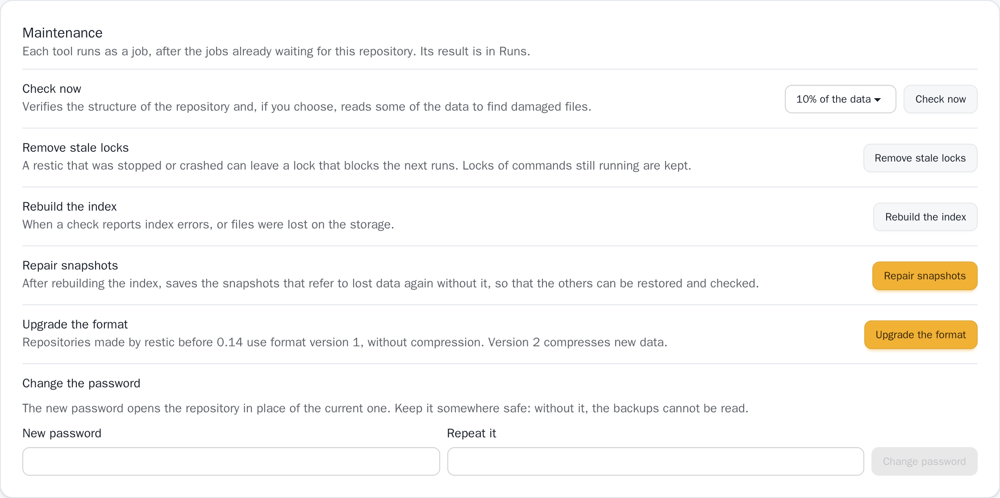

# Maintenance

A repository's **Settings** have a **Maintenance** section with the tools
that otherwise need the restic command line: check the data, remove stale
locks, repair a damaged repository, upgrade an old one, and change its
password. Each tool runs as a job, after the jobs already waiting for the
repository, and its result and log are in **Runs**. The tools that change
the repository for good ask first.

{.screenshot}

## Check the data

`restic check` verifies the structure of the repository: that every
snapshot, folder and file refers to data the index knows. It does not read
the data itself, so a file damaged on the storage goes unnoticed. **Check
now** can also read part of it:

| Choice | Runs | Reads |
| --- | --- | --- |
| No data, only the structure | `restic check` | Nothing but the index and the snapshots |
| 5%, 10% or 25% of the data | `restic check --read-data-subset 10%` | That share of the pack files, chosen at random |
| All the data | `restic check --read-data-subset 100%` | Everything, which downloads the whole repository |

The scheduled [integrity check](/features/backups#schedules) has the same
choice. A monthly check that reads 10% reads, over a year, most of the
repository, at a tenth of the cost of each full read. On cloud storage,
reading data costs transfer.

A failed check says how many errors it found, and when restic suggests it,
to rebuild the index.

## Remove stale locks

restic locks a repository while it works on it. A restic that was killed or
lost its connection can leave its lock behind, and the next jobs then wait,
then fail with "repository is already locked". **Remove stale locks** runs
`restic unlock`, which removes the locks older than 30 minutes or of
processes no longer running on this machine; the locks of commands still at
work stay. ResticGUI stops restic in a way that releases its lock, so a
lock is usually left by something else, such as a restic on another
machine.

## Repair a damaged repository

When files of the repository are lost or damaged on the storage, a check
reports errors. Repair it in this order, as the
[restic troubleshooting guide](https://restic.readthedocs.io/en/stable/077_troubleshooting.html)
says:

1. **Rebuild the index** runs `restic repair index`: restic lists the pack
   files the repository really holds, and writes an index of them. Nothing
   is lost; on a large or remote repository it takes a while.
2. **Check now** again. If it still reports errors, snapshots refer to data
   that is gone.
3. **Repair snapshots** runs `restic repair snapshots --forget`: each
   snapshot that refers to lost data is saved again without it, and the
   damaged one is forgotten. The files that could not be read are gone from
   these snapshots for good; a snapshot left with nothing is removed. The
   other files of the snapshots can be restored again.
4. **Check now** once more, and run a backup: files still on the computer
   are backed up again.

The run says how many snapshots were repaired.

## Upgrade the format

Repositories made by restic before 0.14 use format version 1, which stores
data without compression. **Upgrade the format** runs `restic migrate
upgrade_repo_v2`, which checks the repository, then upgrades it to version
2: new data is compressed, as the [backup options](/features/backups) of a
plan say. Data already stored stays as it is until a prune rewrites it.

The upgrade cannot be undone, and restic older than 0.14 can no longer open
the repository. On a repository already at version 2, it does nothing, and
the run says so.

## Change the password

Type the new password twice and confirm. ResticGUI then:

1. adds a key for the new password, with `restic key add`,
2. saves the new password, encrypted, in place of the old one,
3. removes the key of the old password, with `restic key remove`.

Other keys of the repository, such as one a different computer uses, stay.
Anything else that opens the repository with the old password, such as a
script, stops working. Keep the new password somewhere safe: without it,
the backups cannot be read.

The new password is saved encrypted, like the old one, and is not kept in
the job's history. restic reads it from a temporary file only ResticGUI can
read, deleted as soon as the key is added. The change cannot be stopped once
it started, so that ResticGUI always holds a password that opens the
repository: if saving it fails, the new key is removed and the old password
stays; if removing the old key fails, the run succeeds and says that the old
password still opens the repository.

If the password was changed with restic on the command line instead, enter
the new one in the **Storage** section of the settings.
