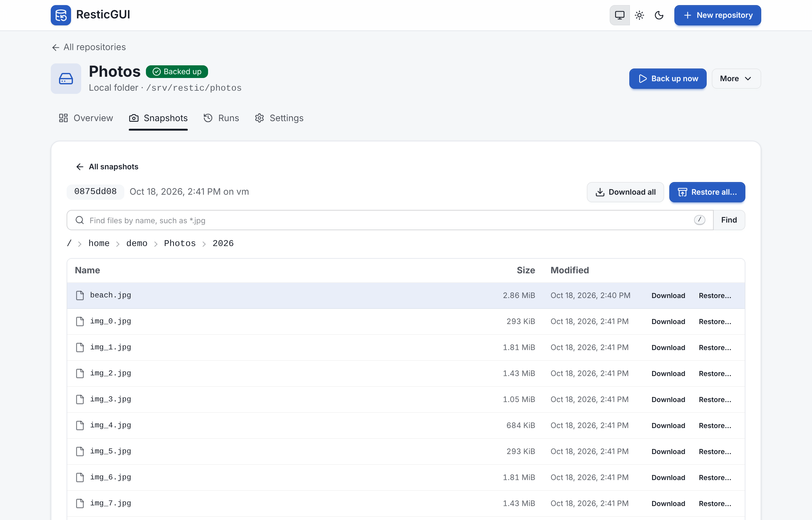
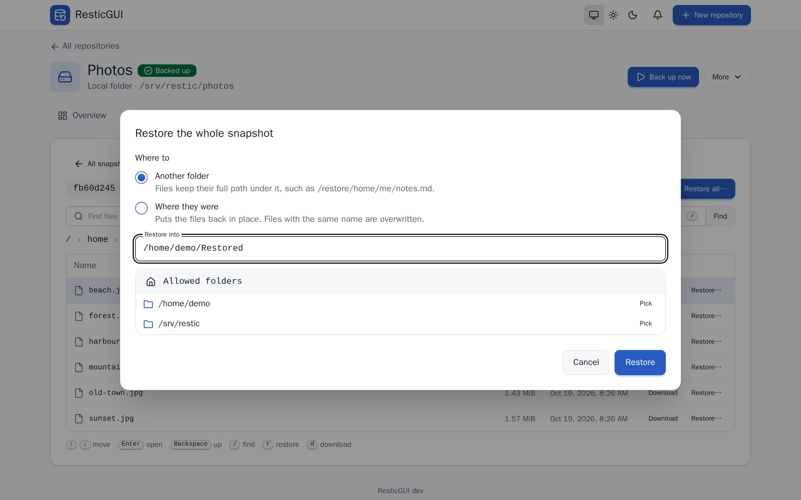

# Browse and restore

The **Snapshots** tab lists the snapshots of the repository, newest first,
with the data each backup added. Turn on **Also snapshots made outside
ResticGUI** to list the ones made by restic on the command line or another
tool.

## Browse

**Browse** opens a snapshot as a file browser, with each file's size and
date. Click a folder to open it, or use the keyboard:

| Key | Does |
| --- | --- |
| <kbd>↑</kbd> <kbd>↓</kbd>, <kbd>Home</kbd> <kbd>End</kbd> | Move the selection |
| <kbd>Enter</kbd> or <kbd>→</kbd> | Open the folder |
| <kbd>Backspace</kbd> or <kbd>←</kbd> | Go up |
| <kbd>/</kbd> | Find files by name |
| <kbd>d</kbd> | Download the selection |
| <kbd>r</kbd> | Restore the selection |

{.screenshot}

**Find** searches the whole snapshot with `restic find`, with patterns such
as `*.pdf` or `report-2025*`.

## Download

**Download** sends a file as it is, or a folder as a zip archive, straight
from the repository: nothing is written on the server. **Download all**
does the same for the whole snapshot.

## Restore

**Restore…** on a file or a folder, or **Restore all…**, opens the restore
dialog:

- **Another folder** writes them under that folder with their full path,
  such as `/restore/home/me/notes.md`; nothing in place is touched.
- **Where they were** puts the files back in place; files with the same
  name are overwritten.

The target has to be under `paths.roots`. The dialog follows the restore
live and tells how many files were restored; you can close it, and the
restore keeps going under **Runs**.

{.screenshot}

## Forget a snapshot

**Forget** removes one snapshot from the repository, with an option to
prune at once. It cannot be undone.
