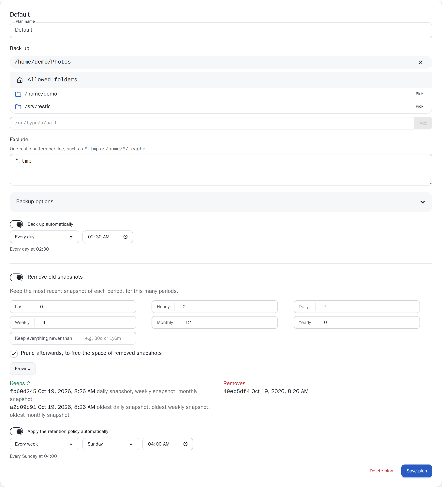

# Retention

Snapshots accumulate. A retention policy says which ones to keep; the
others are removed by `restic forget`, and their space freed by
`restic prune`.

## Rules

Each [backup plan](/features/backups#backup-plans) has its own policy. Turn
on **Remove old snapshots** in the plan's settings and set any of:

| Rule | Keeps |
| --- | --- |
| Last | The newest N snapshots |
| Hourly, Daily, Weekly, Monthly, Yearly | The newest snapshot of each of the last N hours, days, weeks, months, years |
| Keep everything newer than | Every snapshot younger than a duration, such as `30d` or `1y6m` |

A snapshot kept by any rule is kept. The suggested policy keeps 7 daily, 4
weekly and 12 monthly snapshots: about a year of history, with fine detail
for the last week.

**Prune afterwards** frees the space right away. Pruning reads and rewrites
part of the repository, which takes time and, on cloud storage, can cost
transfer; without it, schedule a prune now and then from **More**.

## Preview

**Preview** runs `restic forget --dry-run` with the rules on the form,
before they are saved, and lists which snapshots each rule keeps and which
would be removed.

{.screenshot}

## When it runs

The **Apply the retention policy automatically** schedule runs it, such as
every Sunday at 04:00. It only applies to the snapshots ResticGUI made for
this plan, whatever their paths: snapshots made by restic on the command line, or by
another host, are left alone.
