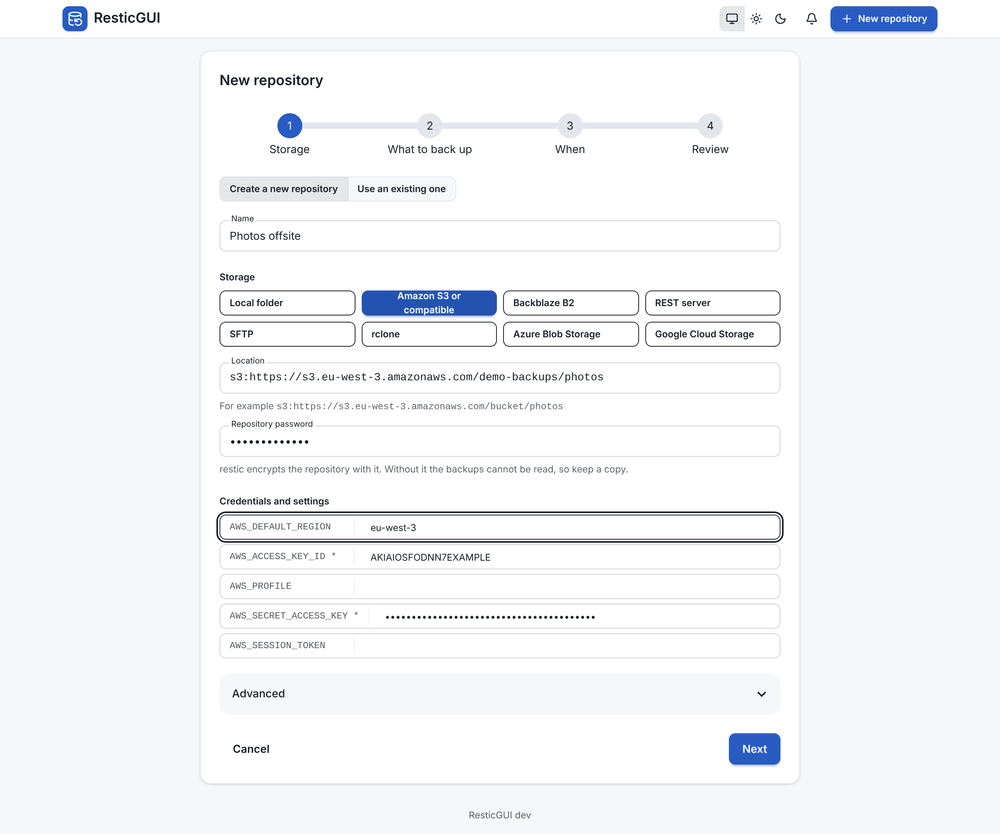
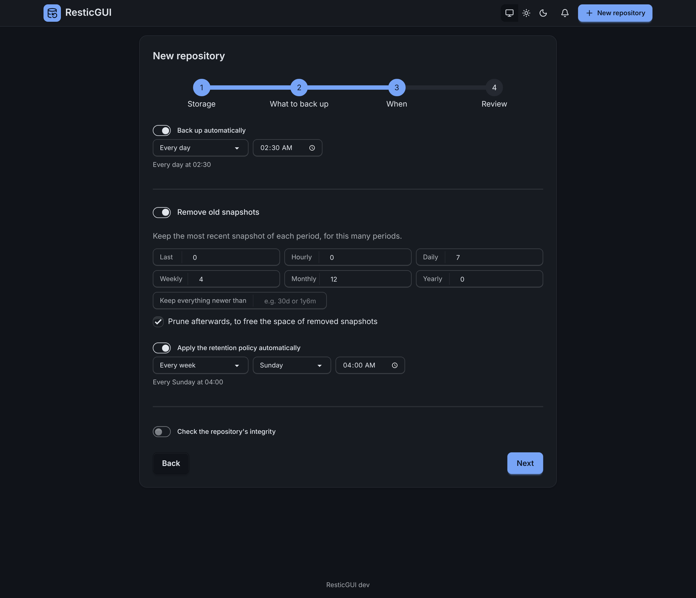
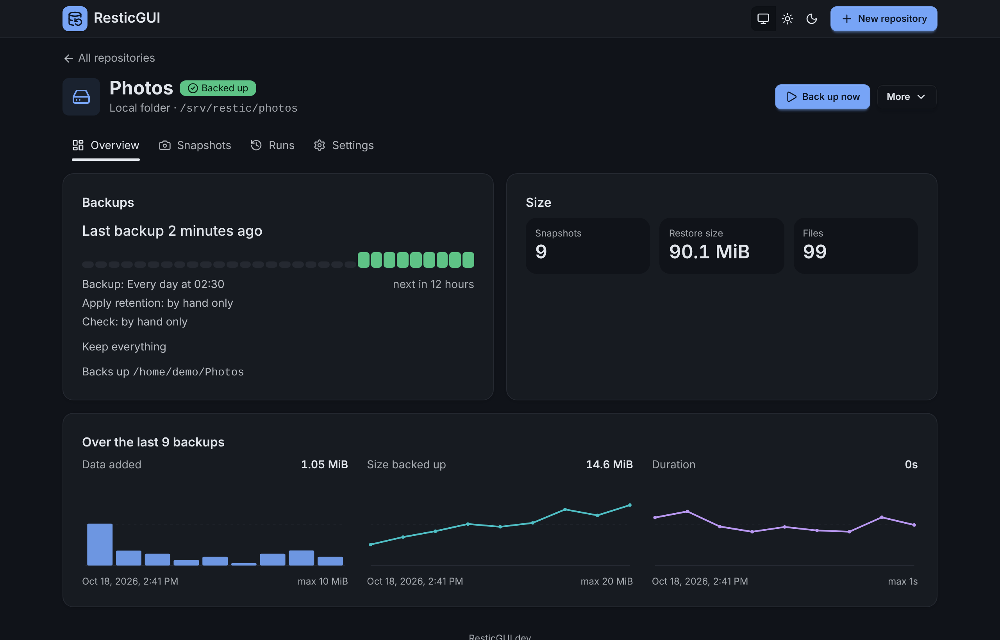

# Your first backup

Open ResticGUI and choose **Add a repository**, or **New repository** at the
top. A repository is where restic keeps the backups: one per destination,
such as a disk or a bucket. It can hold the backups of several folders.

## 1. Storage

Give the repository a name, pick the storage and enter its location. A
local repository is a folder, here `/srv/restic/photos`; the other storages
are described in [storage](/features/storage).

{.screenshot}

Choose a password for the repository. restic encrypts everything with it.
ResticGUI saves it, encrypted, so that schedules can run; **keep a copy
elsewhere too**, as nothing can open the backups without it.

**Create a new repository** runs `restic init` at the end. To add a
repository you already have, choose **Use an existing one**: see
[existing repositories](/features/connect).

## 2. What to back up

Pick folders with the browser, or type their paths, and add exclude
patterns such as `*.tmp` or `/home/*/.cache`. The folders you can pick are
the ones the configuration allows (`paths.roots`).

## 3. When

Back up every day at 02:30, every hour, on some days of the week, or with
any cron expression. Turn on **Remove old snapshots** to keep, for example,
the last 7 daily, 4 weekly and 12 monthly snapshots, and choose when the
cleanup runs. A monthly integrity check is a good habit.

{.screenshot}

## 4. Review

Check the summary and choose **Create repository**. ResticGUI creates the
repository and opens its page. Choose **Back up now** to run the first
backup without waiting for the schedule; the progress shows live.

{.screenshot}

The **Runs** tab keeps the history of every backup, cleanup and check,
with its log. The dashboard shows each repository's last backup at a
glance, and turns red when one needs attention.

Next: [get told when a backup fails](/features/notifications).
