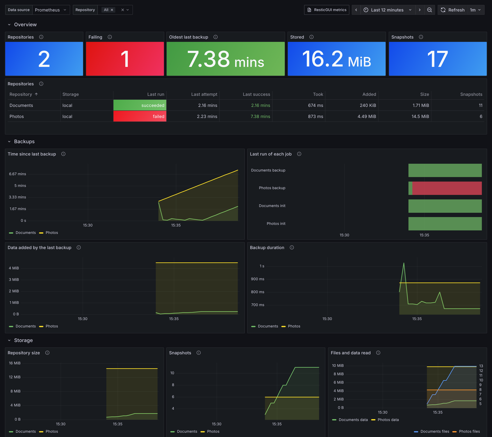

# Prometheus metrics

ResticGUI can serve [Prometheus](https://prometheus.io) metrics at
`/metrics`. It is off by default; turn it on in the configuration:

```yaml
metrics:
  enabled: true
  # when set, scrapes must send "Authorization: Bearer <token>"
  token: "a long random string"
```

`/metrics` is outside the login of the web interface, so set a token
whenever the server is reachable by others. A scrape configuration:

```yaml
scrape_configs:
  - job_name: resticgui
    authorization:
      credentials: a long random string
    static_configs:
      - targets: ["resticgui.example.com:3001"]
```

A scrape reads ResticGUI's database only; it never runs restic. The
repository size and snapshot count are refreshed after each successful
backup, cleanup or init.

## Metrics

| Metric | Labels | Meaning |
| ------ | ------ | ------- |
| `resticgui_repository_info` | `repository`, `backend` | Always 1, one per repository |
| `resticgui_repository_size_bytes` | `repository` | Size of the data in the repository |
| `resticgui_repository_snapshots` | `repository` | Number of snapshots |
| `resticgui_job_last_run_timestamp_seconds` | `repository`, `kind` | When the last job of this kind finished |
| `resticgui_job_last_run_success` | `repository`, `kind` | 1 when it succeeded, 0 otherwise |
| `resticgui_job_last_success_timestamp_seconds` | `repository`, `kind` | When the last successful job of this kind finished |
| `resticgui_backup_last_duration_seconds` | `repository` | How long the last successful backup took |
| `resticgui_backup_last_added_bytes` | `repository` | Data the last successful backup added |
| `resticgui_backup_last_processed_bytes` | `repository` | Data the last successful backup read |
| `resticgui_backup_last_files` | `repository` | Files in the last successful backup |

`kind` is the job kind, such as `backup`, `forget`, `prune`, `check` or
`init`; restores are left out. The Go runtime
and process metrics are there too.

## Alerting

For example, a backup older than a day:

```yaml
- alert: ResticGUIBackupTooOld
  expr: time() - resticgui_job_last_success_timestamp_seconds{kind="backup"} > 86400
  for: 1h
  annotations:
    summary: "No backup of {{ $labels.repository }} for a day"
```

Or a last run that failed:

```yaml
- alert: ResticGUIJobFailed
  expr: resticgui_job_last_run_success == 0
```

## Grafana dashboard

[`deploy/grafana/resticgui-dashboard.json`](../deploy/grafana/resticgui-dashboard.json)
shows the backups and the repositories: how many repositories there are,
which jobs are failing, the age of the oldest last backup, a table with each
repository's last backup, size and snapshots, and graphs of time since the
last backup, run results, data added, duration, repository size and
snapshot count. A **Repository** filter at the top narrows it to some of
them.



To import it, in Grafana open **Dashboards**, **New**, **Import**, upload
the file and pick the Prometheus data source that scrapes ResticGUI. To
provision it instead, put the file in a folder that a dashboard provider
reads:

```yaml
# /etc/grafana/provisioning/dashboards/resticgui.yaml
apiVersion: 1
providers:
  - name: resticgui
    type: file
    options:
      path: /var/lib/grafana/dashboards/resticgui
```

It needs Grafana 10 or later.
